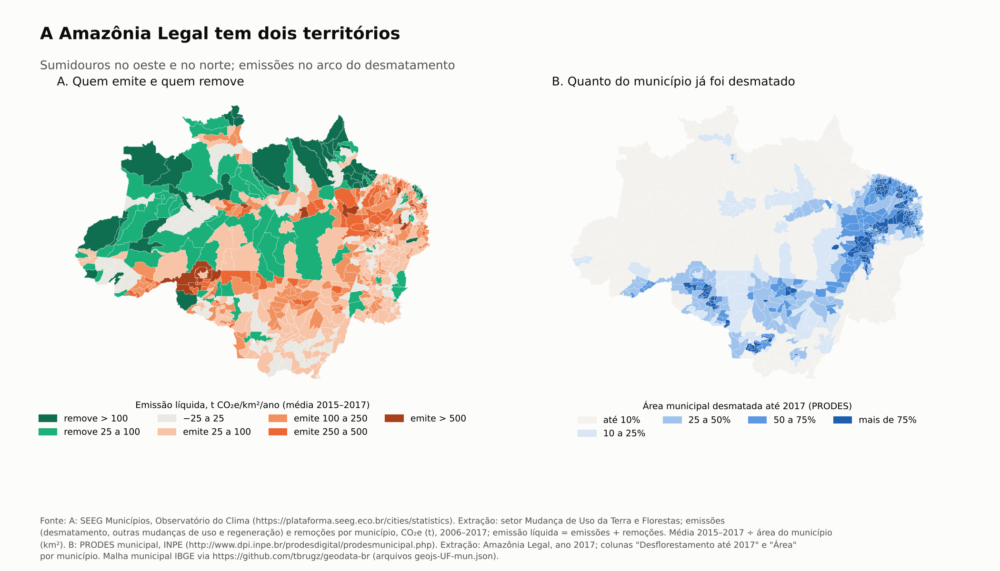

# Quem mitiga, quem emite, quem é compensado
### Justiça climática entre os municípios da Amazônia Legal

Este repositório reúne os dados, o código e as figuras do artigo derivado da monografia de
Marcela Paz da Silva Enriquez (Ciências Econômicas, UFPA; orientação: Prof. Dr. Marcelo Bentes Diniz),
que lê os indicadores dos Objetivos de Desenvolvimento Sustentável 13 e 15 e as emissões municipais
de gases de efeito estufa a partir do conceito de justiça climática.



## Principais achados

- **Poucos municípios removem carbono.** Na média de 2015 a 2017, só 175 dos 760 municípios da Amazônia Legal removeram mais CO₂e do que emitiram.
- **São sempre os mesmos.** Onze municípios (sete no Amazonas, três no Pará, um no Amapá) estiveram entre os 12 maiores sumidouros em pelo menos 10 dos 12 anos entre 2006 e 2017. Eles ocupam 17% da área da região e respondem por metade das remoções dos municípios sumidouros.
- **As emissões também se repetem**, em municípios pecuários do arco do desmatamento: Novo Repartimento e Pacajá (PA) em todos os anos, Porto Velho (RO) em 11 e São Félix do Xingu (PA) em 10.
- **São Félix do Xingu:** a emissão líquida caiu 86% entre 2006 e 2017, enquanto o rebanho bovino cresceu 40%.
- **Em 2025 (SEEG, coleção 14),** os nove estados emitiram 378,0 Mt CO₂e líquidas, 61% menos que em 2006. Pará (−78%) e Rondônia (−71%) puxaram a queda, mas Maranhão ficou estável e Tocantins subiu 27%. Só Amazonas e Amapá removeram mais do que emitiram.
- **O ICMS Verde do Pará não segue quem remove carbono.** Entre 2015 e 2017, os 31 municípios sumidouros fizeram 63% das remoções do estado, mas receberam 30% do ICMS Verde. O maior beneficiário foi São Félix do Xingu, emissor líquido, que liderou os repasses de 2018 a 2021.
- **E quem remove está mais exposto.** 47% dos municípios sumidouros têm risco alto ou muito alto de inundações (AdaptaBrasil, 2015), contra 32% dos emissores; entre os 11 sumidouros recorrentes, são 9.
- **Proteção desigual:** as Unidades de Conservação cobrem 63,4% do bioma no Amapá e 1,1% no Tocantins.

## O que tem em cada pasta

| Caminho | O que é |
|---|---|
| `data/base_justica_climatica_amazonia.xlsx` | **Base organizada**: todas as tabelas em abas, com LEIA-ME (fonte de cada aba) e dicionário de variáveis |
| `data/base/` | A mesma base em CSV, um arquivo por aba |
| `data/raw/` | Dados de entrada como vieram das fontes: painel municipal 2006–2017, extração do SEEG 14 por estado, tabela 4962 do IBGE, lista de municípios da Amazônia Legal e malha municipal |
| `data/processed/` | Tabelas da monografia (`t01`…`t09`) e resultados municipais (`municipal/`) |
| `scripts/` | Código que refaz tudo (ver abaixo) |
| `figures/` | Gráficos com título e fonte, para redes e site |
| `figures/artigo/` | Os mesmos gráficos sem título, para o artigo |
| `docs/errata.md` | Problemas encontrados na monografia e como foram tratados |
| `docs/fontes.md` | Origem de cada arquivo |

## Como reproduzir

```bash
pip install -r requirements.txt
python scripts/00_extrair_seeg_estados.py Dados-nacionais-14_0.xlsx seeg14   # opcional: o CSV já está em data/raw
python scripts/01_tabelas_monografia.py MONOGRAFIA.docx            # opcional: os CSVs já estão em data/processed
python scripts/02_figuras_ods.py
python scripts/03_analise_municipal.py
python scripts/05_icms_verde.py
python scripts/06_risco_inundacoes.py
ARTIGO=1 python scripts/02_figuras_ods.py && ARTIGO=1 python scripts/03_analise_municipal.py && ARTIGO=1 python scripts/05_icms_verde.py && ARTIGO=1 python scripts/06_risco_inundacoes.py
python scripts/06_risco_inundacoes.py
python scripts/04_base_organizada.py
```

O link exato e o passo a passo de extração de cada dado estão em `scripts/fontes.py` e no rodapé de cada figura.

## Fontes

SEEG/Observatório do Clima (SEEG Municípios e coleção 14) · PRODES/INPE · IBGE (Censos Agropecuários 2006 e 2017, PPM, PIB dos Municípios, SIDRA tabela 4962, indicadores ODS) · CNUC/MMA · S2ID/MIDR · MDS · índices do ICMS Verde do Pará (SEMAS-PA) · AdaptaBrasil MCTI · malha municipal via [geodata-br](https://github.com/tbrugz/geodata-br).

## Como citar

ENRIQUEZ, Marcela Paz da Silva; DINIZ, Marcelo Bentes. *Quem mitiga, quem emite, quem é compensado: justiça climática entre os municípios da Amazônia Legal* — dados e código. GitHub, 2026. Disponível em: https://github.com/marcelapazenriquez/justica-climatica-amazonia.

## Licença

Código: MIT. Dados e figuras próprios: CC BY 4.0. Dados de terceiros seguem as licenças das fontes originais.
